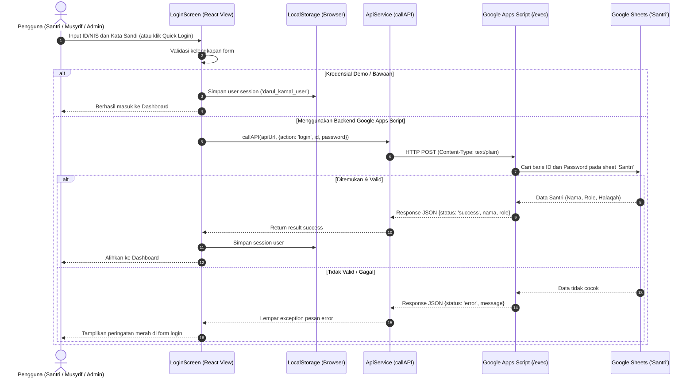
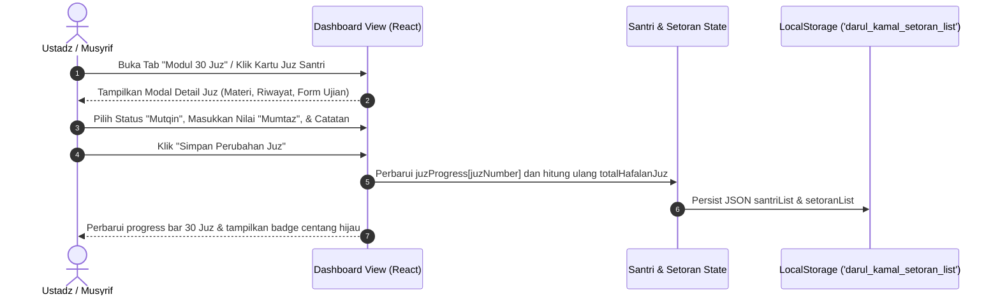
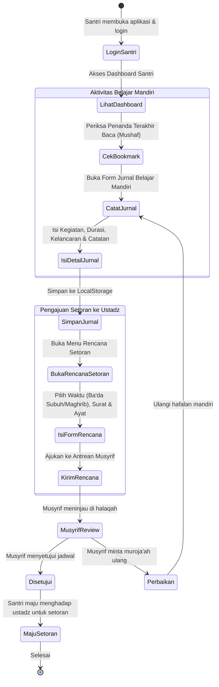
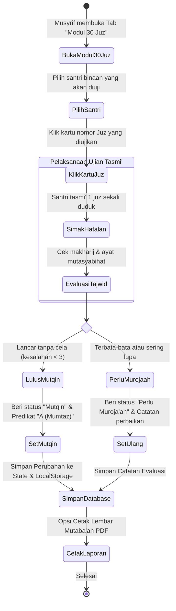

# PRODUCT REQUIREMENT DOCUMENT (PRD)
## Sistem Informasi E-Tahfidz Pondok Pesantren Darul Kamal
**Domain Target:** `e-tahfidz-pp-darul-kamal-asngad.my.id`  
**Institusi:** Pondok Pesantren Darul Kamal & Universitas Nahdlatul Ulama Al Ghazali (UNUGHA)  
**Penyusun:** Asngad (`asngad@mhs.unugha.ac.id`)  
**Versi Dokumen:** 2.2 (Siap Uji Pertemuan ke-6)  
**Tanggal:** Oktober 2026  

---

## 1. Executive Summary & Latar Belakang

Pondok Pesantren Darul Kamal menyelenggarakan program pembinaan tahfidz Al-Qur'an 30 Juz untuk para santri. Selama ini, pencatatan mutaba'ah hafalan santri (baik *Ziyadah* hafalan baru maupun *Muroja'ah* pengulangan) masih mengandalkan buku setoran fisik manual. Sistem konvensional ini memiliki sejumlah kelemahan:
1. **Risiko Kerusakan & Kehilangan Fisik:** Buku setoran santri mudah sobek, basah, atau hilang sehingga rekam jejak progres hafalan bertahun-tahun lenyap.
2. **Ketiadaan Akses Mandiri Santri:** Santri sulit memantau target khatam dan riwayat evaluasi tajwid secara terstruktur di luar jam halaqah.
3. **Keterbatasan Pelaporan Wali Santri & Pimpinan:** Pengasuh pesantren dan wali santri membutuhkan waktu lama untuk mendapatkan rekapitulasi capaian juz santri.
4. **Biaya & Infrastruktur Server:** Pesantren memerlukan sistem digital yang hemat biaya, tanpa keharusan menyewa server database SQL mahal setiap bulan.

Untuk menjawab permasalahan tersebut, dibangun aplikasi **E-Tahfidz PP Darul Kamal** yang memanfaatkan teknologi **Single Page Application (SPA) modern** berbasis **React & TypeScript**, didukung **penyimpanan offline-first (LocalStorage)** serta integrasi cloud gratis tanpa batas menggunakan **Google Sheets & Google Apps Script (GAS)**, yang dapat diakses secara publik melalui domain `e-tahfidz-pp-darul-kamal-asngad.my.id`.

---

## 2. Visi Produk, Tujuan & Target Pengguna

### 2.1 Visi Produk
Menjadi platform manajemen tahfidzul Qur'an terpadu yang memadukan kedisiplinan tradisi pesantren salaf-modern dengan kemudahan teknologi digital tanpa membebani biaya operasional pesantren.

### 2.2 Tujuan Utama
1. Memfasilitasi santri untuk mencatat aktivitas belajar mandiri (*Ziyadah/Muroja'ah*), mengunci penanda bacaan (*bookmark*), dan mengajukan jadwal setoran.
2. Memfasilitasi ustadz/musyrif dalam mencatat nilai tajwid, makhorijul huruf, dan menguji tasmi' per juz dalam **Modul 30 Juz Interaktif**.
3. Menyediakan rekapitulasi data santri dan ekspor laporan (CSV / Lembar Pantau Siap Cetak PDF) bagi administrator pesantren.
4. Mempersiapkan materi **Demo Progress Sistem pada Pertemuan ke-6** perkuliahan/proyek akademik.

### 2.3 Sasaran Pengguna (*User Roles*)
| Role | Deskripsi & Hak Akses |
| :--- | :--- |
| **Santri** | Siswa penghafal Al-Qur'an. Memiliki akses ke Dashboard Pribadi, Jurnal Belajar Mandiri, Rencana Setoran, Bookmark Mushaf, dan Peta 30 Juz miliknya. |
| **Ustadz / Musyrif** | Pembina halaqah tahfidz. Memiliki hak menginput setoran resmi, memberikan nilai predikat (*Mumtaz s.d Maqbul*), menguji tasmi' 30 Juz, dan menyetujui rencana setoran santri. |
| **Administrator** | Pimpinan/Koordinator Tahfidz. Mengelola data master santri, halaqah, integrasi URL Google Apps Script backend, dan rekapitulasi ekspor data pesantren. |

---

## 3. Architecture Design Sistem

Sistem dirancang menggunakan arsitektur **Hybrid Client-Centric Jamstack**:

```
+-----------------------------------------------------------------------------------+
|                        CLIENT TIER (Browser Pengguna)                            |
|                                                                                   |
|  +-----------------------------------------------------------------------------+  |
|  |           React 18 + Vite SPA (TypeScript + Tailwind CSS 3/4)               |  |
|  |                                                                             |  |
|  |  +-------------------+  +-------------------+  +-------------------------+  |  |
|  |  |  Role: Santri     |  | Role: Musyrif     |  | Role: Administrator     |  |  |
|  |  | - Jurnal Mandiri  |  | - Input Setoran   |  | - Master Data Santri    |  |  |
|  |  | - Rencana Setoran |  | - Evaluasi Nilai  |  | - Ekspor CSV & Cetak    |  |  |
|  |  | - Peta 30 Juz     |  | - Ujian Tasmi'    |  | - Konfigurasi Backend   |  |  |
|  |  +-------------------+  +-------------------+  +-------------------------+  |  |
|  +-----------------------------------------------------------------------------+  |
|                                        |                                          |
|                +-----------------------+-----------------------+                  |
|                |                                               |                  |
|                v                                               v                  |
|    +------------------------+                     +------------------------+      |
|    | LocalStorage Engine    |                     | API Service Layer      |      |
|    | (Offline First Cache)  |                     | (fetch POST via CORS)  |      |
|    +------------------------+                     +------------------------+      |
+----------------------------------------------------------------|------------------+
                                                                 |
                                       HTTPS / POST (text/plain) |
                                                                 v
+-----------------------------------------------------------------------------------+
|                       BACKEND TIER (Serverless Cloud)                             |
|                                                                                   |
|  +-----------------------------------------------------------------------------+  |
|  |              Google Apps Script Web App (doPost Handler /exec)              |  |
|  |  - Parser JSON Payload                                                      |  |
|  |  - Auth & Action Dispatcher ('login', 'getSantri', 'saveSetoran', 'ping')   |  |
|  |  - CORS Header Avoidance via ContentService JSON Output                     |  |
|  +-----------------------------------------------------------------------------+  |
|                                        |                                          |
|                                        v                                          |
|  +-----------------------------------------------------------------------------+  |
|  |                       Google Sheets Database (Cloud)                        |  |
|  |  - Sheet 'Santri'  : [NIS, Nama, Password, Kelas, Halaqah, Musyrif, Role]   |  |
|  |  - Sheet 'Setoran' : [ID, NIS, Tanggal, Jenis, Surat, Ayat, Juz, Nilai]     |  |
|  |  - Sheet 'Tasmi'   : [NIS, Juz, Status, NilaiTasmi, Penguji, Catatan]       |  |
|  +-----------------------------------------------------------------------------+  |
+-----------------------------------------------------------------------------------+
```

### 3.1 Komponen Desain Arsitektur
1. **Presentation & UI Layer**: Dibangun menggunakan React SPA dengan Tailwind CSS, styling tipografi Arab (*Amiri font*) dan sans-serif (*Plus Jakarta Sans*), serta ikon FontAwesome.
2. **State & Local Persistence Layer**: Seluruh data transaksi santri, jurnal, dan status 30 juz disimpan secara reaktif di browser menggunakan `localStorage` dengan penanganan fallback, memastikan sistem tetap beroperasi tanpa koneksi internet (*offline-capable*).
3. **Integration Layer (API Service)**: Menggunakan fungsi asynchronous `callAPI` dengan `Content-Type: text/plain;charset=utf-8` untuk meniadakan preflight `OPTIONS` request yang umumnya memicu kendala CORS pada Google Apps Script.
4. **Data Store Layer**: Google Spreadsheet bertindak sebagai database relasional berbasis baris (*row-based record*).

---

## 4. Kebutuhan Fungsional (Functional Requirements)

| Kode FR | Modul | Deskripsi Kebutuhan |
| :--- | :--- | :--- |
| **FR-01** | **Autentikasi** | Sistem memvalidasi kredensial pengguna (Admin, Santri, Ustadz). Menyediakan opsi *Login Cepat 1-Klik* dan *Bypass Demo* saat backend belum terpasang. |
| **FR-02** | **Data Santri** | Admin & Musyrif dapat melihat tabel santri, memfilter berdasarkan halaqah, mencari nama/NIS, serta mendaftarkan santri baru. |
| **FR-03** | **Setoran Resmi** | Musyrif dapat mencatat setoran santri (*Ziyadah/Muroja'ah*), memilih surat dari 114 surat Al-Qur'an, mengisi rentang ayat, nomor juz, predikat (*Mumtaz* s.d *Maqbul*), dan catatan tajwid. |
| **FR-04** | **Modul 30 Juz** | Menampilkan peta 30 Juz (nama Arab, Latin, rentang ayat). Tiap kartu dapat diklik untuk evaluasi kelulusan tasmi' (*Mutqin, Sedang Berjalan, Perlu Muroja'ah, Belum*). |
| **FR-05** | **Jurnal Santri** | Santri dapat mendokumentasikan belajar harian (*Ziyadah Mandiri, Muroja'ah, Talaqqi Simakan, Kajian Tajwid*), durasi belajar, tingkat kelancaran, dan catatan kesulitan ayat. |
| **FR-06** | **Rencana Setoran**| Santri dapat mengajukan jadwal setoran (*Ba'da Subuh, Ashar, Maghrib, Isya*). Musyrif dapat meninjau dan menyetujui jadwal tersebut. |
| **FR-07** | **Bookmark Mushaf**| Santri dapat mengatur penanda bacaan terakhir (*Surat, Ayat, Juz*) serta memantau streak keistiqomahan hari belajar. |
| **FR-08** | **Pelaporan & Cetak**| Sistem dapat mengekspor rekap setoran ke file CSV serta mencetak Lembar Kontrol Mutaba'ah 30 Juz ke format kertas/PDF (@media print). |
| **FR-09** | **Pengaturan Backend**| Pengguna dapat memasukkan URL Web App Google Script, melakukan *Uji Koneksi (Ping Latency)*, atau mereset data lokal ke kondisi awal. |

---

## 5. Kebutuhan Non-Fungsional (Non-Functional Requirements)

1. **Keandalan & Ketersediaan (*Availability*):** Sistem memiliki tingkat ketersediaan tinggi (99.9%) karena di-deploy sebagai static bundle di CDN global (Cloudflare Pages).
2. **Kinerja (*Performance*):** Waktu muat awal (*First Contentful Paint*) < 1.5 detik. Interaksi klik modal dan pergantian tab bersifat instan (< 100 ms).
3. **Responsivitas (*Usability*):** Tampilan mobile-friendly 100% responsif pada perangkat smartphone santri/ustadz (layar 360px ke atas) maupun laptop/komputer desktop kantor.
4. **Keamanan Data (*Security*):** URL API disimpan aman di penyimpanan lokal klien; tidak ada kredensial atau rahasia server yang terekspos ke publik.
5. **Aksesibilitas Cetak (*Printability*):** Lembar kendali 30 Juz diformat secara presisi agar tidak memotong elemen saat dicetak melalui browser.

---

## 6. Diagram UML (Unified Modeling Language)

### 6.1 Use Case Diagram

Diagram Use Case menggambarkan interaksi antara ketiga aktor (Santri, Ustadz/Musyrif, dan Administrator) dengan sistem:

```mermaid
graph TD
    Santri((Santri))
    Musyrif((Ustadz / Musyrif))
    Admin((Administrator))

    subgraph "Sistem E-Tahfidz PP Darul Kamal"
        UC1[Login Aplikasi / Demo 1-Klik]
        UC2[Melihat Dashboard & Bookmark Hafalan]
        UC3[Mencatat Jurnal Belajar Mandiri]
        UC4[Mengajukan Rencana Jadwal Setoran]
        UC5[Melihat Peta Capaian 30 Juz]
        UC6[Mencatat Setoran Resmi & Nilai Tajwid]
        UC7[Menyetujui Rencana Setoran Santri]
        UC8[Menguji & Evaluasi Tasmi' 30 Juz]
        UC9[Melihat & Mengelola Data Santri]
        UC10[Mendaftarkan Santri Baru]
        UC11[Ekspor Rekap Setoran CSV]
        UC12[Cetak Lembar Pantau 30 Juz PDF]
        UC13[Konfigurasi URL Google Apps Script]
        UC14[Uji Koneksi Backend Latency]
    end

    Santri --> UC1
    Santri --> UC2
    Santri --> UC3
    Santri --> UC4
    Santri --> UC5
    Santri --> UC12

    Musyrif --> UC1
    Musyrif --> UC2
    Musyrif --> UC5
    Musyrif --> UC6
    Musyrif --> UC7
    Musyrif --> UC8
    Musyrif --> UC9
    Musyrif --> UC11
    Musyrif --> UC12

    Admin --> UC1
    Admin --> UC2
    Admin --> UC5
    Admin --> UC6
    Admin --> UC8
    Admin --> UC9
    Admin --> UC10
    Admin --> UC11
    Admin --> UC12
    Admin --> UC13
    Admin --> UC14
```



---

### 6.2 Sequence Diagram

#### A. Sequence Diagram: Autentikasi Pengguna


#### B. Sequence Diagram: Pencatatan Setoran Hafalan & Evaluasi Tasmi'


---

### 6.3 Activity Diagram

#### A. Activity Diagram: Alur Belajar & Pengajuan Setoran Santri


#### B. Activity Diagram: Alur Pengujian & Evaluasi Modul 30 Juz oleh Musyrif


---

## 7. Rencana Demo Progress pada Pertemuan ke-6

Dokumen ini disusun sebagai panduan resmi pelaksanaan **Demonstrasi Kemajuan Proyek (Milestone Pertemuan ke-6)** di hadapan dosen pengampu / penguji / stakeholder pesantren:

### 7.1 Skenario Demonstrasi Live (Demo Checklist)

| No | Modul yang Didemokan | Langkah Skenario Pengujian | Hasil yang Diharapkan |
| :---: | :--- | :--- | :--- |
| **1** | **Login & Multi-Role** | 1. Buka aplikasi di browser.<br>2. Klik tombol login cepat **Santri** (NIS: `12345`).<br>3. Verifikasi role santri aktif.<br>4. Keluar, lalu login sebagai **Admin** (`admin`/`admin123`). | Masuk ke antarmuka yang sesuai dengan hak akses masing-masing role tanpa error. |
| **2** | **Ruang Belajar Santri** | 1. Login sebagai Santri.<br>2. Periksa widget **Penanda Terakhir Baca**.<br>3. Klik *Catat Belajar Hari Ini*, isi Surat Al-A'raf ayat 46-60 (durasi 40 menit).<br>4. Simpan jurnal. | Catatan langsung bertambah di tabel riwayat jurnal, streak harian bertambah. |
| **3** | **Pengajuan Jadwal Setoran**| 1. Di akun santri, klik *Ajukan Jadwal Setoran*.<br>2. Pilih waktu *Ba'da Subuh*, materi Ziyadah Juz 8.<br>3. Simpan. | Status muncul "Diajukan" di antrean santri dan musyrif. |
| **4** | **Modul 30 Juz Interaktif** | 1. Buka Tab *Modul 30 Juz*.<br>2. Periksa peta visual (Juz 1 s/d 30).<br>3. Klik Juz 8 yang sedang berjalan.<br>4. Update status menjadi **Mutqin**, nilai **A (Mumtaz)**, ustadz penguji.<br>5. Simpan. | Kartu Juz 8 berubah menjadi hijau centang, persentase total hafalan otomatis naik. |
| **5** | **Data Persistence Test** | Lakukan *Hard Reload* browser (Ctrl + F5 / Cmd + Shift + R). | Seluruh data jurnal dan status juz yang baru diubah **tidak hilang** dan tetap tersimpan. |
| **6** | **Cetak & Ekspor Data** | 1. Klik *Ekspor CSV* di Tab Setoran.<br>2. Klik *Cetak Lembar Pantau 30 Juz*. | File CSV terunduh secara instan, dialog print browser membuka lembar kontrol tahfidz resmi. |
| **7** | **Pengaturan Backend GAS** | Buka Tab Pengaturan, tunjukkan kode `Code.gs` dan tombol *Uji Koneksi API*. | Penguji dapat melihat kesiapan integrasi cloud Google Sheets. |

### 7.2 Data Dummy Uji Coba Pertemuan ke-6
- **Administrator**: `admin` / `admin123` (KH. Ahmad Ridwan, Lc.)
- **Santri**: `12345` / `santri123` (Muhammad Fauzan Al-Hafidz, Kelas XI IPA, 7 Juz Mutqin)
- **Ustadz / Musyrif**: `ustadz` / `ustadz123` (Ustadz Abdullah Mukhtar, S.Pd.I)

---

## 8. Panduan Deployment Domain

Aplikasi dikonfigurasi untuk dipublikasikan pada domain resmi:  
🌐 **`e-tahfidz-pp-darul-kamal-asngad.my.id`**

### Langkah Konfigurasi DNS & Hosting:
1. **Build Artefak SPA**:
   ```bash
   npm run build
   ```
   Menghasilkan folder `dist/` yang berisi `index.html`, bundle JavaScript teroptimasi, dan aset statis.
2. **Deploy ke Cloudflare Pages / Static Hosting**:
   - Hubungkan repositori Git atau upload folder `dist/`.
   - Konfigurasi Custom Domain pada Cloudflare Pages: `e-tahfidz-pp-darul-kamal-asngad.my.id`.
3. **DNS Setting di Registrar Domain (.my.id)**:
   - Type: `CNAME`
   - Name: `e-tahfidz-pp-darul-kamal` (atau `@` untuk root domain)
   - Target: `<project-name>.pages.dev`
   - Proxy status: DNS Only / Proxied SSL Aktif (HTTPS otomatis gratis).

---

## 9. Kesimpulan & Rencana Pasca Pertemuan ke-6

Aplikasi **E-Tahfidz PP Darul Kamal** telah memenuhi seluruh kriteria kelayakan sistem fungsional, arsitektural, dan diagramatis. Pasca Pertemuan ke-6, pengembangan dapat dilanjutkan dengan:
- Penambahan integrasi notifikasi WhatsApp Gateway ke nomor wali santri setiap kali santri menyelesaikan tasmi' per Juz.
- Mode audio tilawah murottal Al-Qur'an 30 Juz langsung di dalam aplikasi untuk membantu santri menghafal secara mandiri.
